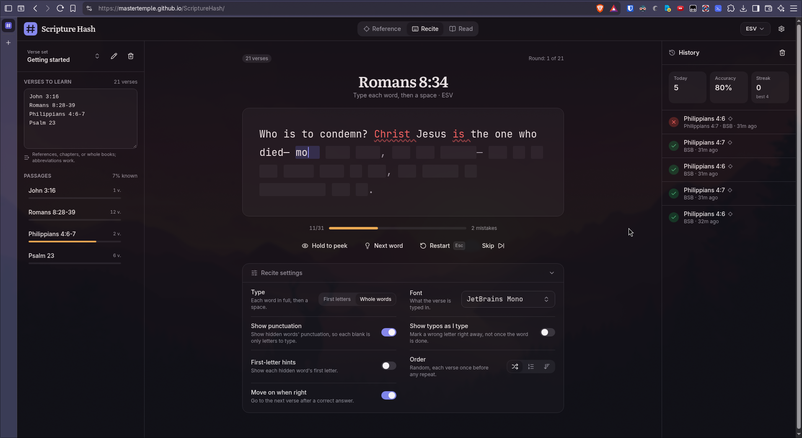

# Scripture Hash

Memorize Bible verses _and_ where they are.

**Use it: [mastertemple.github.io/scripture-hash](https://mastertemple.github.io/scripture-hash/)**

- **Reference**: see a verse and name its book, chapter, and verse. Choose which parts you're asked for.
- **Recite**: see a reference and type the verse, either each word's first letter or whole words. It works with phone keyboards and has hints, peeking, and word-by-word feedback. Type it in any font: the bundled ones, any of [Fontsource](https://fontsource.org)'s ~2,000 (searchable, each previewed in itself, and saved for offline use once chosen), or one installed on your device (Chrome and Edge on desktop).
- **Read**: read through your selection, colored by how well you know each verse. Tap a verse to practice it.

Write what to learn the way you'd write it anywhere, e.g. `Rom 8:28-39; Ps 23`, `John 1:1-18`, or a whole book like `James`. You can keep several named verse sets. Verses come up shuffled (each once per round), in order, or weakest first, and the app tracks your progress per verse.

[](https://mastertemple.github.io/scripture-hash/)

## Bibles

- **Built in**: BSB, KJV, WEB, ASV, LSV, and YLT. Each book downloads from [fetch.bible](https://fetch.bible) the first time it's needed and is then kept in IndexedDB, so it works offline.
- **Browse more**: search fetch.bible's ~1,400 translations in many languages.
- **Upload your own**: a `.zip` of a whole Bible in USFM or USX (for example eBible.org's `*_usfm.zip`), an OSIS file of one book or a whole Bible, or individual `.usfm`/`.sfm`/`.usx` book files. Files are parsed on your device and never uploaded anywhere.

## How it's built

- React 19, TypeScript, Vite, Tailwind CSS v4, and Radix primitives (shadcn-style components in `src/components/ui`)
- [topos-bible](https://www.npmjs.com/package/topos-bible) finds, parses, and completes references: the selection editor, book suggestions, and verse expansion (`src/bible/topos.ts`)
- [logoxide](https://www.npmjs.com/package/logoxide) reads USFM, USX, OSIS, and zips into per-verse text. It runs in a Web Worker so its WebAssembly only loads when a book is first needed (`src/bible/parse.ts`, `src/bible/worker.ts`)
- zustand for state (settings, sets, history, and progress persist in localStorage)

```bash
npm install
npm run dev        # http://localhost:5173
npm test           # unit tests (parsing, grading, ordering)
npm run build      # static site in dist/
```

The build is a static site with no server or API keys, and its URLs are relative, so it can be hosted under any path. Each push to `main` tests, builds, and deploys it to GitHub Pages (`.github/workflows/deploy.yml`).
